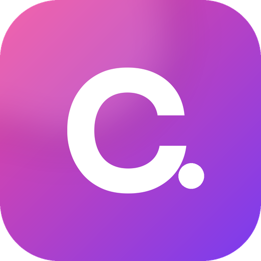
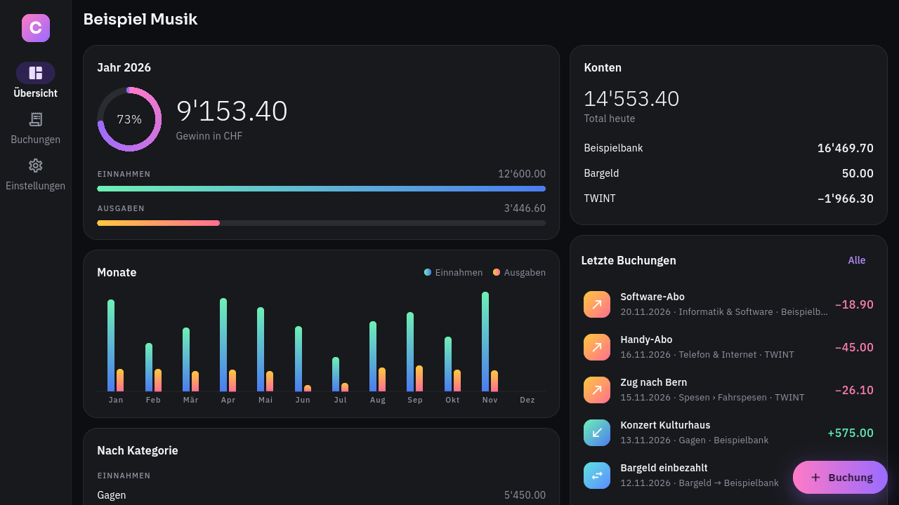
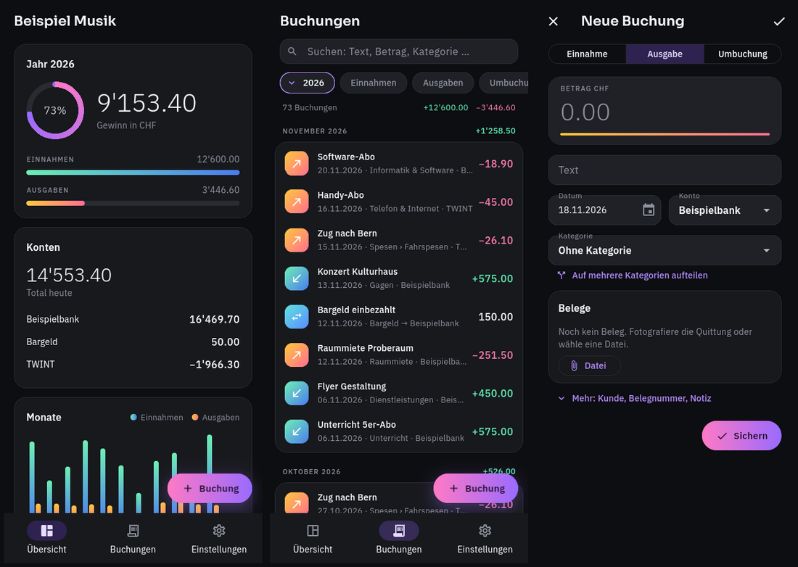

<h1 align="center">Conti</h1>

<b>Bookkeeping for self-employed people in Switzerland</b> 
For Windows and Android · Open source (GPL-3.0) · <a href="README.md">Deutsch</a>

---

Conti is a simple cash book for sole traders and freelancers: income, expenses, receipts and accounts in one place, on your computer and on your phone. Clients, orders, invoices with the Swiss QR payment part and the year-end report for your tax return come next.

## What Conti does today

- **Record entries:** income, expenses and transfers between your own accounts, with date, description, account and category. One receipt can be split across several categories.
- **Accounts** such as bank, PostFinance, cash and TWINT, with opening and current balance.
- **Categories** for self-employed people, ready to use and editable, including subcategories (e.g. Expenses → Travel).
- **Receipts** attached to any entry: take a photo on your phone, or choose a PDF or image on the computer.
- **Overview:** profit of the year, income and expenses, monthly bars, totals per category, account balances.
- **Search and filter** by year, type, account, category and text.
- **Clients** with address, contact and notes. The client card shows orders, tasks, entries and the amount due.
- **Products** with price and unit (flat, per hour, per lesson, per piece).
- **Orders** of any kind (gig, lesson pack, design job …) with items and a status from “open” to “paid”. You define the order kinds yourself.
- **Lesson packs** with any number of lessons: tick off lessons, Conti counts and reminds you when the pack is used up. One button creates the next pack.
- **Tasks** with a deadline and colours (yellow, orange, red), on the home page and in the client card, plus **reminder notifications** on Android and Windows.
- **My business:** name, address, IBAN (validated, recognises QR-IBANs), logo, signature, canton. Everyone sets up their own business, none of it is built into the program.
- **Import** from the previous bookkeeping app (`.json` file), with a preview. Importing twice creates no duplicates.
- **Sync via Dropbox** between Windows and Android: at start-up, every two minutes and shortly after every change. What two devices record offline is merged. The data lives in your Dropbox in the “Apps” folder.
- **Backups:** automatically once a day, plus by hand as a ZIP file. Restoring never deletes anything.
- **Light and dark**, German and English. Works with finger, pen, mouse and keyboard.
- **Updates** right in the app: *Settings → About Conti → Check for updates*.

## Coming soon

- [x] **Dropbox** sync between Windows and Android
- [x] **Clients, products and orders** (gig, lesson pack, design job …) and **tasks** with deadline colours
- [ ] **Invoices** as PDF with the **Swiss QR payment part**, recording payments, reminders
- [ ] **Year-end report** for the tax return (all cantons, Lucerne first)
- [ ] **VAT** in case you become liable (8.1 %, 2.6 %, 3.8 %, effective or net tax rate method)

## Install

The latest version is under [Releases](https://github.com/rawkhawk0663/conti/releases/latest).

- **Windows 10/11:** download and run `Conti-Setup.exe`. If Windows says "Windows protected your PC": *More info → Run anyway*. Without installing: unzip `Conti-Windows.zip` and run `Conti.exe`.
- **Android:** download `Conti-Android.apk` on your phone and open it. Android asks whether apps from this source may be installed.

## Your data

Conti has no account and no server. Everything stays on your devices (on Windows in `%APPDATA%\Conti\Conti\Daten`) and, if you connect it, in your own Dropbox. Deleted items are kept as a marker and can be restored, because bookkeeping records must be kept for 10 years in Switzerland.

## Licence

Conti is free software under the [GNU General Public License v3.0](LICENSE). You may use, change and share Conti. Changed versions must stay open under the GPL-3.0 as well.

Fonts: [Sora](https://fonts.google.com/specimen/Sora) and [IBM Plex Sans](https://fonts.google.com/specimen/IBM+Plex+Sans), both under the SIL Open Font License.
