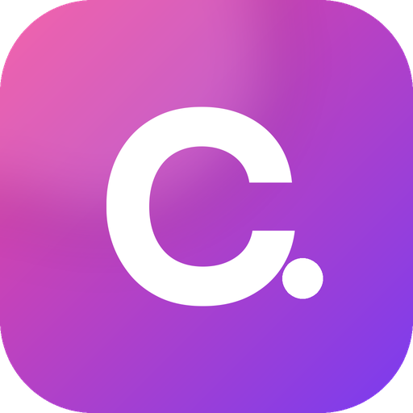
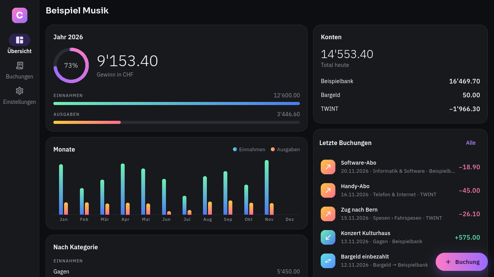
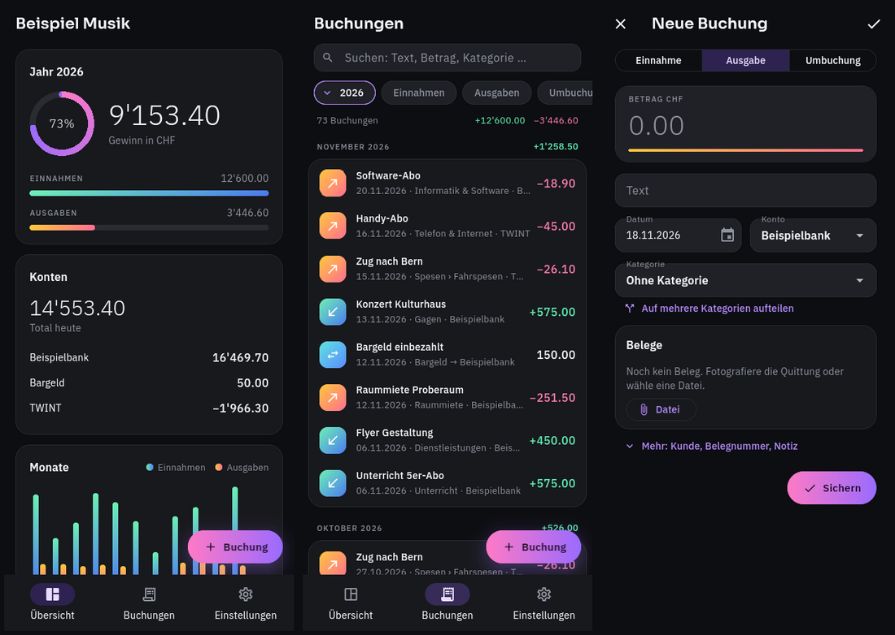

<h1 align="center">Conti</h1>

<b>Buchhaltung für Selbständige in der Schweiz</b> 
Für Windows und Android · Open Source (GPL-3.0) · <a href="README.en.md">English</a>

---

Conti ist ein Kassenbuch („Milchbüechli“) für Einzelfirmen und Selbständige: Einnahmen, Ausgaben, Belege und Konten an einem Ort, auf dem Computer und auf dem Handy. Dazu Kundinnen und Kunden, Aufträge, Rechnungen mit Schweizer QR-Zahlteil und der Jahresabschluss für die Steuererklärung.

## Was Conti heute kann

- **Buchungen erfassen:** Einnahmen, Ausgaben und Umbuchungen zwischen eigenen Konten, mit Datum, Text, Konto und Kategorie. Eine Quittung lässt sich auf mehrere Kategorien aufteilen.
- **Konten** wie Bank, PostFinance, Bargeld und TWINT, mit Anfangsbestand und aktuellem Saldo.
- **Kategorien** für Selbständige, fertig eingerichtet und änderbar, auch mit Unterkategorien (z. B. Spesen → Fahrspesen).
- **Belege** an jede Buchung hängen: auf dem Handy direkt fotografieren, am Computer PDF oder Bild wählen.
- **Übersicht:** Gewinn des Jahres, Einnahmen und Ausgaben, Monatsbalken, Summen pro Kategorie, Kontostände.
- **Suchen und filtern** nach Jahr, Art, Konto, Kategorie und Text.
- **Kunden** mit Adresse, Kontakt und Notizen. Die Kundenkarte zeigt Aufträge, Aufgaben, Buchungen und den offenen Betrag.
- **Produkte** mit Preis und Einheit (pauschal, pro Stunde, pro Lektion, pro Stück).
- **Aufträge** jeder Art (Gig, Lektionen-Abo, Grafik …) mit Positionen und Stand von „offen“ bis „bezahlt“. Auftragsarten legst du selbst an.
- **Abos** mit frei wählbarer Anzahl Lektionen: Lektionen abhaken, Conti zählt mit und erinnert, wenn das Abo aufgebraucht ist. Mit einem Knopf entsteht das nächste Abo.
- **Rechnungen als PDF mit Schweizer QR-Zahlteil:** aus einem Auftrag mit einem Knopf. Logo, Absender, Empfänger, Positionen, Dankeszeile mit Unterschrift und Zahlteil mit Empfangsschein. Normale IBAN mit Mitteilung oder QR-IBAN mit QR-Referenz. Rechnungen werden aufbewahrt und nie verändert, lassen sich öffnen, per E-Mail oder WhatsApp senden und speichern.
- **Zahlungen erfassen:** Die Einnahme wird gebucht, mit der Rechnung als Beleg, und der Auftrag steht auf „bezahlt“. Offene und überfällige Rechnungen erscheinen auf der Startseite, dazu eine Erinnerung am Tag nach der Frist und auf Knopfdruck eine **Zahlungserinnerung** als PDF.
- **Jahresabschluss für die Steuererklärung:** Einnahmen und Ausgaben, Vermögen am 1. Januar und 31. Dezember, Privatbezüge und Privateinlagen, mit einer Kontrolle, ob alles aufgeht. Als PDF zum Beilegen und als Tabelle (CSV) für Excel oder eine Treuhänderin. Für **Luzern** stehen die Beträge gleich bei den Feldern der Formulare S2 und S3. Danach lässt sich das Jahr abschliessen, die Buchungen sind dann gesperrt.
- **Abschreibungen:** Eine grössere Anschaffung (Instrument, Verstärker, Laptop) markierst du in der Buchung als „Anschaffung“. Conti schreibt sie jedes Jahr ab, nach den Sätzen der Steuerverwaltung.
- **Privatanteile** für Auto (pauschal 0,9 % pro Monat), Handy oder Internet, dazu privat bezahlte Geschäftskosten wie ein Arbeitszimmer. Für Geld zwischen Geschäft und Privat gibt es die Kategorien „Privatbezug“ und „Privateinlage“.
- **Für Steuern zurücklegen:** Die Startseite zeigt, wie viel du ungefähr zur Seite legen solltest (Prozentsatz einstellbar).
- **Aufgaben** mit Frist und Farb-Ampel (gelb, orange, rot), auf der Startseite und in der Kundenkarte, dazu **Erinnerungen als Mitteilung** auf Android und Windows.
- **Mein Geschäft:** Name, Adresse, IBAN (mit Prüfung, erkennt QR-IBAN), Logo, Unterschrift, Kanton. Jede Person richtet ihr eigenes Geschäft ein, nichts davon steht im Programm.
- **Import** aus der früheren Buchhaltungs-App (Datei `.json`), mit Vorschau. Ein zweiter Import erzeugt nichts doppelt.
- **Abgleich über Dropbox** zwischen Windows und Android: beim Start, alle zwei Minuten und kurz nach jeder Änderung. Was zwei Geräte ohne Netz erfassen, wird zusammengeführt. Die Daten liegen in deiner Dropbox im Ordner „Apps“.
- **Sicherungen:** automatisch einmal am Tag, dazu von Hand als ZIP-Datei. Einspielen löscht nie etwas.
- **Hell und dunkel**, Deutsch und Englisch. Bedienbar mit Finger, Stift, Maus und Tastatur. Rechtsklick (oder langes Drücken) öffnet bei Buchungen, Kunden, Aufträgen, Produkten und Aufgaben ein Menü. Escape schliesst die offene Seite. Am Computer ohne Titelleiste, mit drei runden Fensterknöpfen oben rechts; verschieben am Logo.
- **Updates** direkt in der App: *Einstellungen → Über Conti → Nach Updates suchen*.

## Kommt bald

- [x] Abgleich über **Dropbox** zwischen Windows und Android
- [x] **Kunden, Produkte und Aufträge** (Gig, Lektionen-Abo, Grafik-Auftrag …) und **Aufgaben** mit Fristen-Ampel
- [x] **Rechnungen** als PDF mit **Schweizer QR-Zahlteil**, Zahlungen verbuchen, Zahlungserinnerungen
- [x] **Jahresabschluss** für die Steuererklärung (für alle Kantone, Formularfelder zuerst für Luzern)
- [ ] Formularfelder für **weitere Kantone**
- [ ] **MWST**, falls man pflichtig wird (8,1 %, 2,6 %, 3,8 %, effektiv oder Saldosteuersatz)

## Installieren

Unter [Releases](https://github.com/rawkhawk0663/conti/releases/latest) liegt die neueste Version.

- **Windows 10/11:** `Conti-Setup.exe` herunterladen und starten. Meldet Windows „Der Computer wurde durch Windows geschützt“: *Weitere Informationen → Trotzdem ausführen*. Ohne Installation: `Conti-Windows.zip` entpacken und `Conti.exe` starten.
- **Android:** `Conti-Android.apk` auf dem Handy herunterladen und öffnen. Android fragt, ob Apps aus dieser Quelle installiert werden dürfen.
- **Android mit automatischen Updates:** In der App [Obtainium](https://github.com/ImranR98/Obtainium) „App hinzufügen“ wählen und `https://github.com/rawkhawk0663/conti` eintragen. Obtainium meldet und installiert jede neue Version.

## Deine Daten

Conti hat kein Konto und keinen Server. Alles liegt auf deinen Geräten (unter Windows in `%APPDATA%\Conti\Conti\Daten`) und, wenn du es verbindest, in deiner eigenen Dropbox. Gelöschtes bleibt als Vermerk erhalten und lässt sich zurückholen, weil Buchhaltungsunterlagen 10 Jahre aufbewahrt werden müssen.

## Lizenz

Conti ist freie Software unter der [GNU General Public License v3.0](LICENSE). Du darfst Conti nutzen, verändern und weitergeben. Veränderte Fassungen müssen ebenfalls unter der GPL-3.0 offen bleiben.

Schriften: [Sora](https://fonts.google.com/specimen/Sora), [IBM Plex Sans](https://fonts.google.com/specimen/IBM+Plex+Sans) und [Arimo](https://fonts.google.com/specimen/Arimo) (SIL Open Font License), [Roboto Slab](https://fonts.google.com/specimen/Roboto+Slab) (Apache License 2.0).
